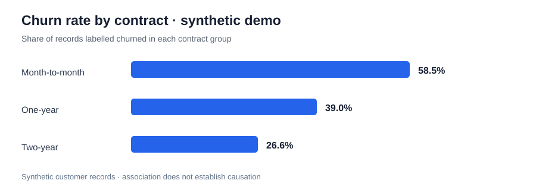

[](https://github.com/Mrroof/customer-churn-analysis/actions)

# Customer Churn and Retention Analysis

> **Portfolio case study · Python · pandas · scikit-learn · Matplotlib**

## Executive summary
This project examines customer churn patterns in a synthetic subscription dataset and builds a baseline classification model to identify records associated with churn.

## Business questions
- What proportion of the demo customer base churned?
- How does churn differ across contract types?
- How well does a logistic regression model distinguish churn from retention?

## Demonstration findings
- Dataset size: **1,000 synthetic customer records**.
- Overall demo churn rate: **48%**.
- Month-to-month contracts had a **58.5%** churn rate, compared with **39.0%** for one-year and **26.6%** for two-year contracts.
- Held-out model accuracy: **72%**; ROC AUC: **0.778**.
- Churn-class precision: **72%**; recall: **70%**.



These are patterns in the generated dataset, not evidence that contract length causes churn.

## Method
1. Inspect data quality and churn distribution.
2. Explore churn by contract type and selected customer attributes.
3. Train a logistic regression classifier.
4. Evaluate using a held-out sample, class-level precision/recall and ROC AUC.

## Run locally
```bash
pip install -r requirements.txt
python src/analyze_churn.py
```

Outputs are saved in `outputs/`.

## Business interpretation
The synthetic contract pattern suggests a useful retention question: should month-to-month customers receive earlier engagement or clearer renewal options? This is a hypothesis to test with genuine customer data, not a recommendation to deploy directly.

## Limitations
The data is synthetic and does not contain real customer records. Model metrics are illustrative. A production churn model requires representative data, leakage checks, probability calibration, time-based validation, fairness review, cost-sensitive evaluation and business validation.

## Repository structure

```text
data/customer_churn_demo.csv    # Synthetic customer records
src/analyze_churn.py            # EDA and baseline classifier
docs/churn-by-contract.svg      # Churn comparison chart
requirements.txt                # Python dependencies
.github/workflows/              # Automated repository validation
```

## Reproducibility

Run the command above from the repository root. The script regenerates analysis outputs locally in `outputs/`; generated outputs are not committed by default. The GitHub Actions validation workflow checks the project on repository updates.

## Business insights

- The synthetic sample has a **48%** overall churn rate.
- Month-to-month customers show **58.5%** churn, compared with **39.0%** for one-year contracts and **26.6%** for two-year contracts.
- The baseline logistic regression achieves **72%** held-out accuracy and **0.778 ROC AUC**, indicating useful separation in this generated dataset, but not proof of real-world performance.
- The contract pattern is an association in the sample. It does not establish that changing a customer's contract will itself prevent churn.

## Practical recommendations

1. Use contract type as a starting point for retention investigation, not as the sole trigger for intervention.
2. Examine churn alongside tenure, service issues, monthly charges, payment experience and customer feedback.
3. Test targeted retention offers or service interventions with a controlled comparison group.
4. Measure retained customer value and intervention cost, not just the number of customers retained.
5. Validate the model on real, time-ordered customer data before operational use and review for uneven impact across customer groups.
